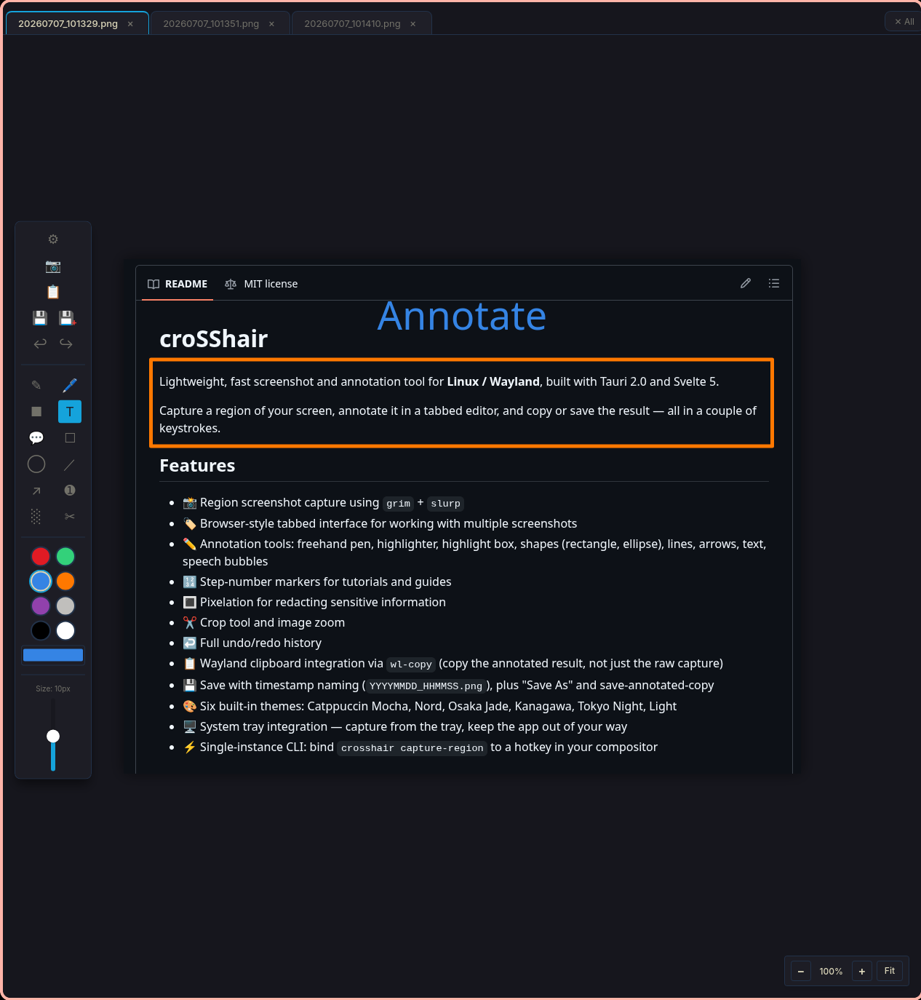
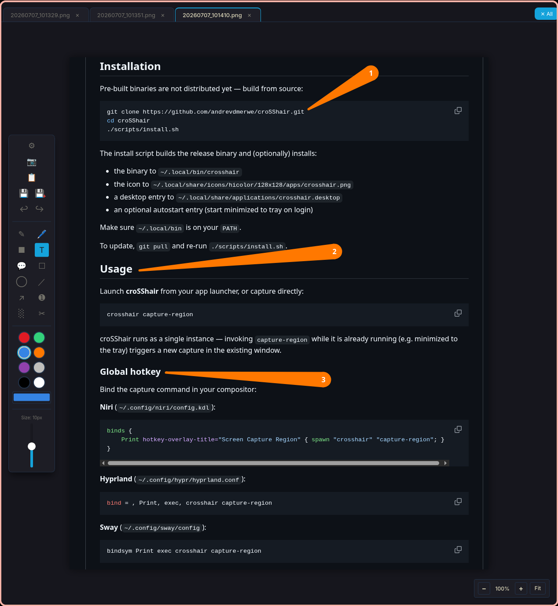
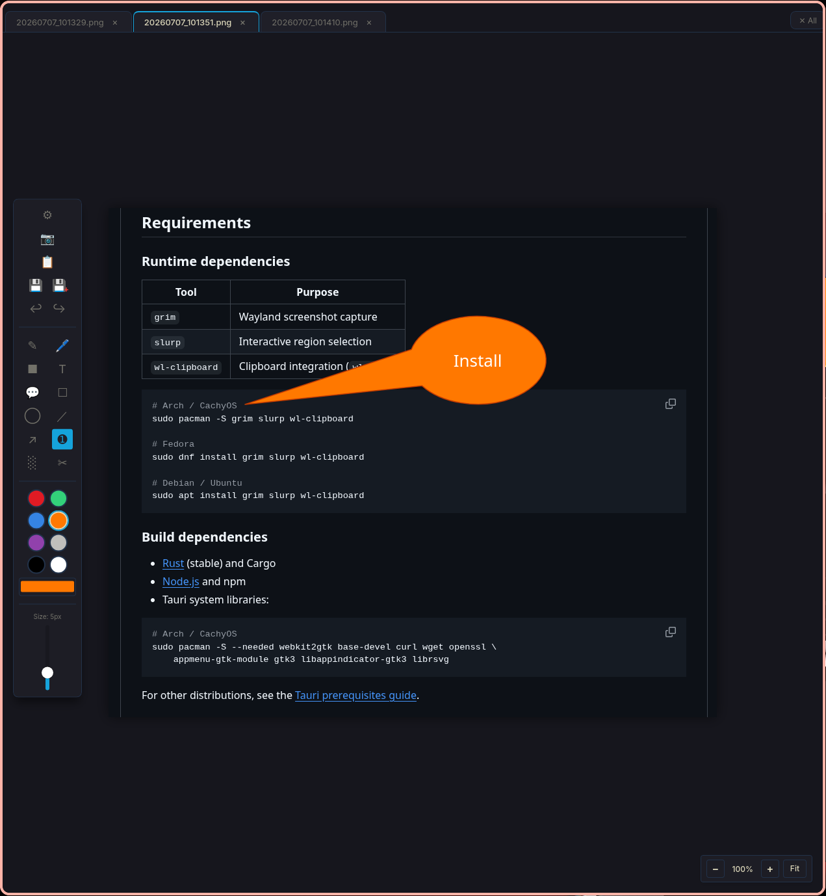
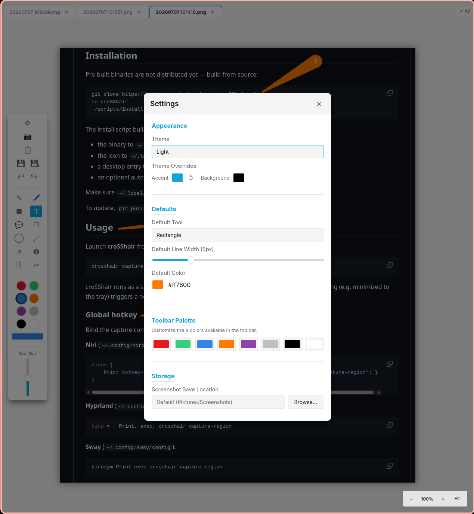

# croSShair

Lightweight, fast screenshot and annotation tool for **Linux / Wayland**, built with Tauri 2.0 and Svelte 5.

Capture a region of your screen, annotate it in a tabbed editor, and copy or save the result — all in a couple of keystrokes.

## Why croSShair?

On Windows, [PicPick](https://picpick.app/) was part of my daily workflow, and when I
moved to Linux (Niri on Wayland) I couldn't find anything that replaced it. Plenty of
screenshot tools exist, but none of them matched the workflow I actually relied on:

- **Capture in the background, without interruption** — take a screenshot and keep
  working; the app collects it without stealing focus or forcing you to deal with it
  immediately.
- **Multiple captures in one tabbed app** — grab five screenshots in a row while
  reproducing a bug or writing a guide, then annotate them all afterwards, each in
  its own tab.
- **Auto-saving** — every capture lands on disk with a timestamped name the moment
  it's taken. Nothing is lost if you never get around to editing it.

Most Linux tools invert this: they capture one image, pop up an editor, and make you
finish with it before you can take the next shot. croSShair is my attempt at bringing
the PicPick-style capture-now-annotate-later workflow to Wayland.

A note on how it was built: I'm not a full-time coder — software development isn't my
day job. croSShair was built with heavy use of AI-assisted development, with me steering
the requirements, design, and testing. If you spot things a seasoned Rust or Svelte
developer would do differently, that's probably why — issues and pull requests are
very welcome.



<details>
<summary><strong>More screenshots</strong></summary>

Arrows and step-number markers:



Speech bubbles:



Settings — themes, defaults, toolbar palette, and save location:



</details>

## Features

- 📸 Region screenshot capture using `grim` + `slurp`
- 🏷️ Browser-style tabbed interface for working with multiple screenshots
- ✏️ Annotation tools: freehand pen, highlighter, highlight box, shapes (rectangle, ellipse), lines, arrows, text, speech bubbles
- 🔢 Step-number markers for tutorials and guides
- 🔳 Pixelation for redacting sensitive information
- ✂️ Crop tool and image zoom
- ↩️ Full undo/redo history
- 📋 Wayland clipboard integration via `wl-copy` (copy the annotated result, not just the raw capture)
- 💾 Save with timestamp naming (`YYYYMMDD_HHMMSS.png`), plus "Save As" and save-annotated-copy
- 🎨 Six built-in themes: Catppuccin Mocha, Nord, Osaka Jade, Kanagawa, Tokyo Night, Light
- 🖥️ System tray integration — capture from the tray, keep the app out of your way
- ⚡ Single-instance CLI: bind `crosshair capture-region` to a hotkey in your compositor

## Compositor Compatibility

croSShair captures via `grim`, which requires a compositor implementing the **wlr-screencopy** protocol. This includes:

- Sway
- Niri
- Hyprland
- river
- Wayfire
- most other wlroots-based compositors

GNOME (Mutter) and KDE Plasma (KWin) do **not** support wlr-screencopy, so capture will not work there out of the box. Support for the xdg-desktop-portal screenshot API is on the wish list — contributions welcome.

## Requirements

### Runtime dependencies

| Tool | Purpose |
|------|---------|
| `grim` | Wayland screenshot capture |
| `slurp` | Interactive region selection |
| `wl-clipboard` | Clipboard integration (`wl-copy`) |

```bash
# Arch / CachyOS
sudo pacman -S grim slurp wl-clipboard

# Fedora
sudo dnf install grim slurp wl-clipboard

# Debian / Ubuntu
sudo apt install grim slurp wl-clipboard
```

### Build dependencies

- [Rust](https://www.rust-lang.org/tools/install) (stable) and Cargo
- [Node.js](https://nodejs.org/) and npm
- Tauri system libraries:

```bash
# Arch / CachyOS
sudo pacman -S --needed webkit2gtk base-devel curl wget openssl \
    appmenu-gtk-module gtk3 libappindicator-gtk3 librsvg
```

For other distributions, see the [Tauri prerequisites guide](https://tauri.app/start/prerequisites/).

## Installation

Pre-built binaries are not distributed yet — build from source:

```bash
git clone https://github.com/andrevdmerwe/croSShair.git
cd croSShair
./scripts/install.sh
```

The install script builds the release binary and (optionally) installs:

- the binary to `~/.local/bin/crosshair`
- the icon to `~/.local/share/icons/hicolor/128x128/apps/crosshair.png`
- a desktop entry to `~/.local/share/applications/crosshair.desktop`
- an optional autostart entry (start minimized to tray on login)

Make sure `~/.local/bin` is on your `PATH`.

To update, `git pull` and re-run `./scripts/install.sh`.

## Usage

Launch **croSShair** from your app launcher, or capture directly:

```bash
crosshair capture-region
```

croSShair runs as a single instance — invoking `capture-region` while it is already running (e.g. minimized to the tray) triggers a new capture in the existing window.

### Global hotkey

Bind the capture command in your compositor:

**Niri** (`~/.config/niri/config.kdl`):

```kdl
binds {
    Print hotkey-overlay-title="Screen Capture Region" { spawn "crosshair" "capture-region"; }
}
```

**Hyprland** (`~/.config/hypr/hyprland.conf`):

```ini
bind = , Print, exec, crosshair capture-region
```

**Sway** (`~/.config/sway/config`):

```
bindsym Print exec crosshair capture-region
```

## Configuration

Settings are available in-app (gear icon) and persisted to `~/.config/croSShair/config.json` (respects `$XDG_CONFIG_HOME`):

```json
{
  "screenshotDirectory": "/home/you/Pictures/Screenshots",
  "copyAfterCapture": false,
  "defaultColor": "#ff0000",
  "defaultStrokeWidth": "medium"
}
```

| Key | Description |
|-----|-------------|
| `screenshotDirectory` | Where captures are saved (default: `~/Pictures/Screenshots`) |
| `copyAfterCapture` | Copy the capture to the clipboard immediately after taking it |
| `defaultColor` | Default annotation color |
| `defaultStrokeWidth` | `thin`, `medium`, or `thick` |

Theme and tool preferences are stored per-user by the UI.

## Development

```bash
npm install          # install frontend dependencies
npm run tauri dev    # run with hot reload
npm run tauri build  # production build
npm run check        # svelte-check / type checking
```

### Tech stack

- **Backend**: Rust + Tauri 2.0 (`src-tauri/`)
- **Frontend**: Svelte 5 (runes) + TypeScript + Vite + SvelteKit (static adapter)
- **Rendering**: dual `<canvas>` layers — base image + annotation overlay

## Contributing

Issues and pull requests are welcome. Particularly appreciated:

- xdg-desktop-portal capture backend (GNOME/KDE support)
- packaging (AUR, Flatpak, Nix)
- new annotation tools and themes

## License

[MIT](LICENSE) © Andre van der Merwe
