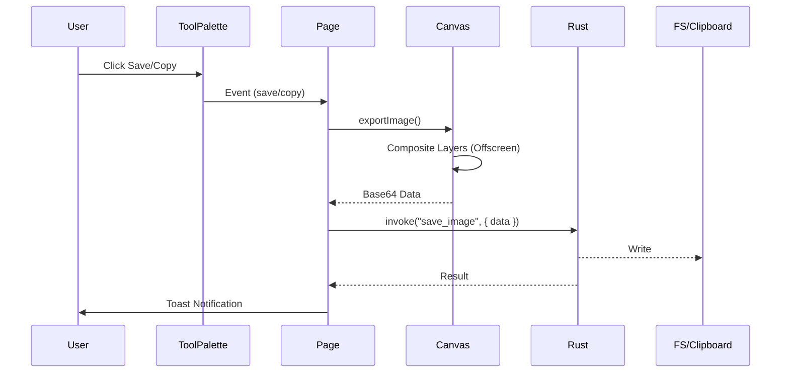

# Design: Output and Sharing

## Architecture

The output generation (flattening) will happen on the **Frontend**. The **Backend** (Rust) will handle the I/O (File System and Clipboard).

### Frontend Composition
The application currently uses a two-layer canvas system:
1.  `baseCanvas`: Contains the potentially resized/scaled screenshot.
2.  `overlayCanvas`: Contains the vector drawings (annotations).

To export, we will:
1.  Create an off-screen `HTMLCanvasElement` sized to the **original image** dimensions (not the scaled CSS display size).
2.  Draw the `baseCanvas` content onto it.
3.  Draw the `overlayCanvas` content onto it.
4.  Extract the data as a Base64 PNG string (`toDataURL('image/png')`).

This ensures that the output is high-resolution validation of the "WYSIWYG" requirement.

### Rust Commands
New commands will be exposed in `src-tauri/src/export.rs` (new module):
- `save_image(base64_data: String, file_path: Option<String>) -> Result<String, String>`
- `copy_image_to_clipboard(base64_data: String) -> Result<(), String>`

### Component Interaction
1.  `ToolPalette` emits `save` or `copy` events.
2.  `+page.svelte` listens to these events.
3.  `+page.svelte` calls a new exposed method on `Canvas.svelte`: `exportImage()`.
4.  `Canvas.svelte` performs the composition and returns the blob/base64.
5.  `+page.svelte` invokes the appropriate Rust command.

## Data Flow

## Decisions
- **Frontend Composition**: We choose to flatten in the browser because we already have the rendering context there. Re-implementing the vector drawing logic in Rust (e.g. using `cairo`) would be redundant and error-prone (drift between renders).
- **Base64 Transfer**: Transferring large image data via Base64 string has overhead, but for screenshots (typically < 5MB), it is acceptable and significantly simpler than binary buffer handling in the current Tauri/Svelte bridge.

## Risks
- **Memory Usage**: Creating a third full-size canvas for export might spike memory usage on very large screenshots (4K+).
- **Clipboard Compatibility**: `wl-copy` expects raw bytes. We must ensuring the Base64 is correctly decoded to binary before piping to `wl-copy`.
